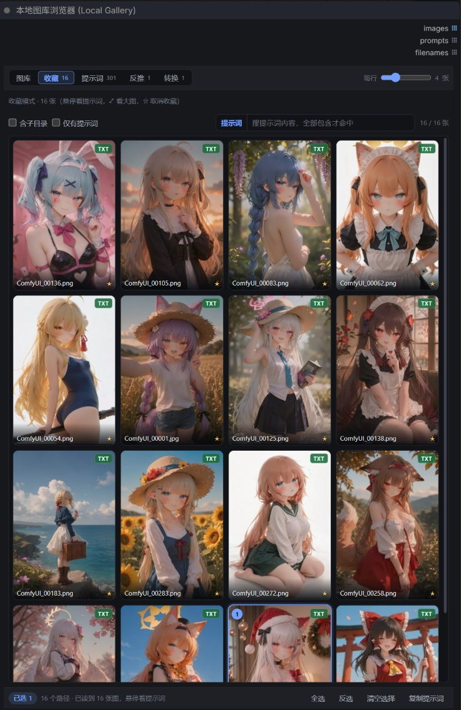
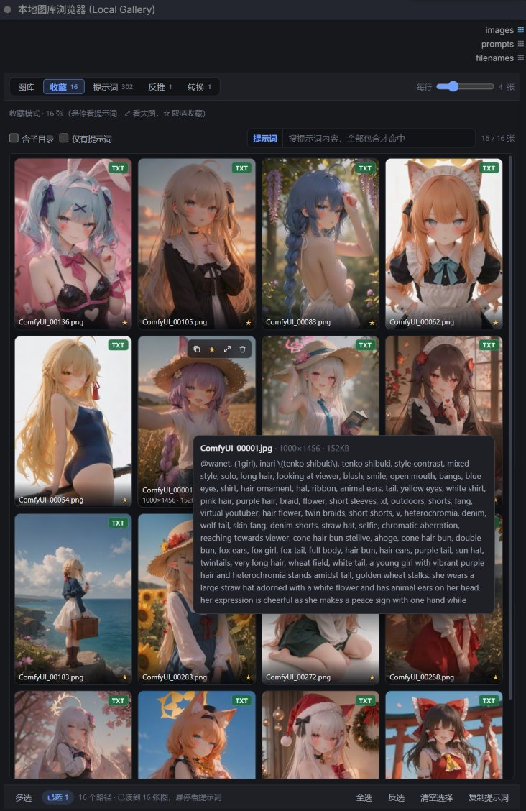
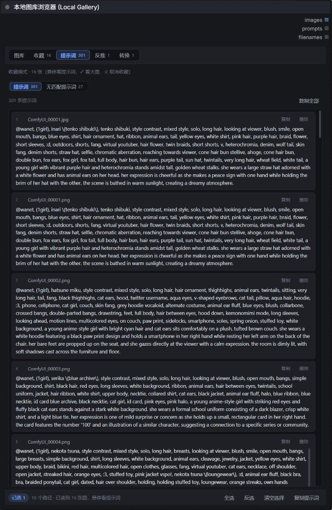
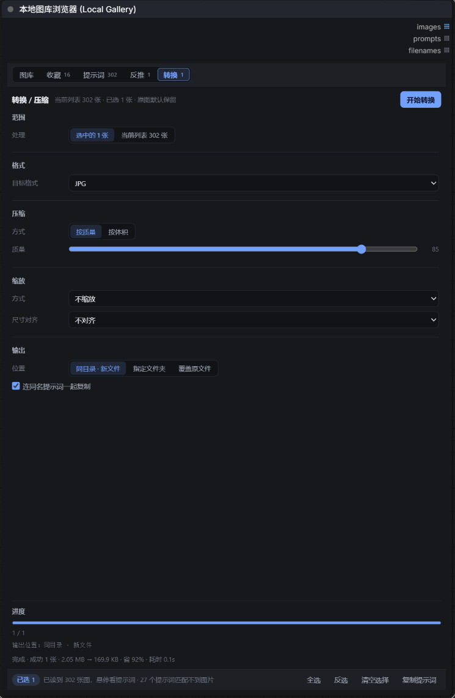
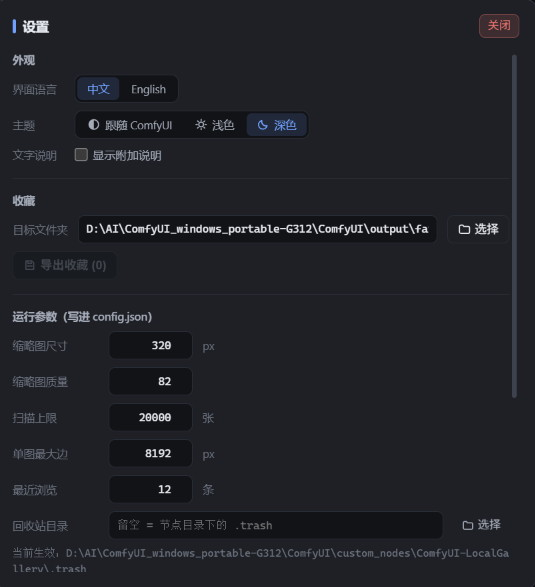

# 本地图库浏览器 · ComfyUI Local Gallery

在 ComfyUI 里直接浏览本机图片文件夹：瀑布流看缩略图、悬停读同名提示词、点选后由节点按列表逐张输出。
**纯离线** —— 不联网、不需要账号、不往模型目录写缓存。

[中文](README.md) ｜ [English](README_EN.md)



---

## 为什么用它

- **不用先上传**：路径指向本地文件夹（或单张图），刷出来就是瀑布流；几百张也不卡
- **提示词就在旁边**：同目录同名的 `.txt / .caption / .json` 自动配对，悬停即看，选图时不用来回翻文件
- **跨文件夹也能配**：图片在 `output/`、提示词在 `output/提示词/`，只要两个目录都在路径列表里，同名就会配上
- **选完即出图**：选中的图片 + 对应提示词写进隐藏参数，执行时按顺序逐个输出，接 KSampler / SaveImage 直接跑批量
- **配套齐全**：打标（WD14 / TIPO / Qwen3.5-VL）、批量转格式压缩、收藏、回收站，都在同一个节点里

---

## 安装

**方式一：ComfyUI Manager（推荐）**

1. 打开 ComfyUI 菜单 → **Manager** → **Custom Nodes Manager**
2. 搜索 `local-gallery` 或 `Local Gallery`
3. 点 **Install** → 重启 ComfyUI

> 已发布到 [Comfy Registry](https://registry.comfy.org/nodes/local-gallery)。新版本提交后要过一轮官方安全审核，刚发布的几分钟内可能还搜不到，稍等再试，或先用下面的方式安装。

**方式二：git clone（之后 `git pull` 即可更新）**

```bash
cd ComfyUI/custom_nodes
git clone https://github.com/wanet36/ComfyUI-LocalGallery.git
```

**方式三：下载压缩包**

1. 打开 [仓库首页](https://github.com/wanet36/ComfyUI-LocalGallery) → 绿色 **Code** 按钮 → **Download ZIP**
2. 解压，把整个 `ComfyUI-LocalGallery` 文件夹放进 `ComfyUI/custom_nodes/`（确保压缩包里多余的 `-main` 后缀目录名已改回）

**装完之后**

1. 重启 ComfyUI
2. 画布右键 → **local gallery** → **本地图库浏览器 (Local Gallery)**

> 本节点自身**不需要额外依赖**，只用 ComfyUI 自带的 `Pillow` / `numpy` / `torch`。
> 唯一的可选依赖是「反推」：打标复用已装的 `ComfyUI-WD14-Tagger`（需 `onnxruntime`），扩写复用 `z-tipo-extension`（需 `kgen` + `llama-cpp-python`），Qwen 反推复用 `comfyUI-llama-TE` + `models/LLM` 里的 gguf。都没装时节点照常工作，只有反推页不可用。

---

## 界面导览

从上到下五块：

| 区域 | 内容 |
|---|---|
| **顶栏** | 六个页签 `图库 / 收藏 / 提示词 / 反推 / 转换 / 图像对比`（数量放在悬停提示里，不上按钮）；最右边是 `设置` / `重新扫描` |
| **路径栏**（图库页 / 收藏页） | 最左 **网格 · 列表滑块** → `时间分组`；右边依次排序按钮、批量区（`全选` / `清空选择`，收藏页多一颗 `取消收藏 (N)`）、回收站，最右是搜索框（搜索范围按钮在框内左侧） |
| **文件夹行**（仅图库页） | 路径栏下面一行 chips：`全部` + 每个加入的目录（带张数），点一下只显示该目录里的图，选中项记在本地 |
| **内容区** | 瀑布流缩略图（按原比例，不裁方），滚到底自动加载下一页（每页 80 张）；可切**列表模式**（一行一张：缩略图 + 文件名 + 分辨率体积 + 提示词标签） |
| **底栏** | **单选 / 多选滑块开关**（点哪边就滑到哪边）、已选计数、状态提示 |

### 图像对比

顶栏最右边的 **`图像对比`** 页签（也可在图库选中两张图 → 右键 →「图像对比」直接进来）：
左右两张图叠在一起比，和 Goohaitools 的 Image Compare 一个用法。

- **对比方式**：左边一颗按钮，点一下循环 `滑块 → 并排 → 差异`（按钮上写着当前方式）
  - **滑块**：中间一条分割线，线左边是 A、右边是 B，按住线拖
  - **并排**：左右各占一半，两边一起缩放平移
  - **差异**：两张图叠加做差，重合的地方发黑，不一样的地方才亮 —— 找微小改动用这个
- **分割方向**：旁边那颗按钮在 `左右` / `上下` 之间切（只在滑块模式出现，竖线/横线）
- **缩放**：滚轮以光标为中心缩放（20%–1600%），按住拖动平移；右边那颗在 `1:1`（原始像素）和 `适应窗口` 之间切换，双击画面也能复位。A/B 两侧始终同步，不会比歪
- **换图**：两张图跟着图库的选中走 —— 选中两张进来就是这两张；工具栏里「左右/上下」右边那颗 `交换 A/B` 一键对调
- 底部显示两边的文件名、分辨率与体积，方便确认是不是同一张图的不同版本

### 右键菜单

在缩略图（或列表行）上**右键**，一级菜单：`复制提示词` / `加入收藏夹` / `反推` / `转换` / `删除…▸`：

- 右键没选中的图会先只选它；右键已在选择里的图，动作对整个选择生效
- `删除…` 是二级菜单，悬停或点击在右侧展开，三个口径和图库页一致（全部 / 只提示词 / 只图片）
- 正好选中 **两张** 时会多一项 `图像对比`，点了直接跳到对比页比这两张
- `在文件夹中显示`：**只在选中一张时出现**，调 `explorer /select` 直接在资源管理器里选中这张图
- 这五项原来在底栏和路径栏上，现在都收进右键菜单，面板更干净；提示词页的批量删除按钮照旧保留

### 加路径

节点里**路径列表是唯一入口**：

- 入口在 **设置（⚙）→「浏览本机路径」**，两个按钮：
  - **选择文件夹…** = 弹 **Windows 系统自带的文件夹选择框**（资源管理器同款），可按住 `Ctrl` 多选几个目录，确定后整批加入
  - **面板内浏览** = 精简版浏览页：顶部一行**当前路径** + **＋ 加入此文件夹**，下面的「最近」切回看过的目录，主区域只列**图片**，勾选后点「添加选中图片」；已加入的路径在那一行，点 `✕` 单独移除（没有路径输入框 / 盘符 / 文件夹树，换目录用系统选择框）
- 选择框是在**跑 ComfyUI 的这台机器**上弹的（本机使用最自然；如果 ComfyUI 跑在远程服务器，框会出现在服务器上，这时用面板内浏览）
- 框弹出时会**自动置顶并闪任务栏**；如果它被浏览器挡住，状态栏会写「选择框已弹出」。框还开着时再点「选择文件夹」只会提示，不会又开一个
- 系统选择框不可用时（非 Windows、远程、被拦截），状态栏会说明原因，改用面板内浏览或再试一次
- 同一区块下面还有 **扫描** 两个勾选：`含子目录`（连子文件夹一起扫）/ `仅有提示词`（只列有同名 .txt 的图），勾了立刻重扫（原来在工具栏，做进设置后那一行更清爽）

路径可以是文件夹、单张图片，也可以混着加；同一个文件被多条路径带出来只算一次。

**重启不丢**：路径同时记在浏览器 `localStorage` 和节点目录的 `.last_paths.json`，优先级是 **工作流里的路径 > 本地 > 服务端**，补上时会提示「已接上上次的路径」。

### 看与选



- 点缩略图 = 选中 / 取消，`Shift + 点击` = 连选
- **只看某个文件夹**：路径栏下面那行 chips 列出 `全部` 和每个加入的目录（名字 + 张数，悬停看完整路径），点一下就只显示这个目录下的图，再点 `全部` 恢复；筛选会跟着搜索、排序、保存的选择一起生效，被筛掉的图会从「已选」里剔掉，选择记在本地，换页签回来还是这个目录；**收藏页不参与筛选**（那里是跨目录清单，那行也不显示）
- **网格 / 列表**：路径栏最左那颗滑块切换（`网格` ↔ `列表`） —— 一行一张图，左边小缩略图，中间是文件名、`分辨率 · 体积`、以及把提示词按逗号切成的标签块（超出省略），右边是行号和悬停时才出现的复制 / 收藏 / 预览 / 删除。**鼠标停在缩略图上会弹出放大预览**：优先浮在面板外侧（右侧放不下翻左侧），面板顶到屏幕边时贴在面板内右侧，垂直对齐当前行；预览只是看，不挡点击、不参与框选，滚动或按下就收起。列表模式**也支持时间分组**（组标题 + 组内行列表，同样可折叠）和**左键框选**（拖出的矩形碰到哪几行就选哪几行）。选择 / 全选 / 删除 / 排序 / 搜索照常，偏好记在本地
- **时间分组**：路径栏里的 `时间分组` 按钮一开，缩略图就按**文件修改时间**一天一坨（`今天` / `昨天` / `前天` / `11 月 12 日`），组标题带张数、滚动时吸顶、点一下折叠；各组列宽对齐，组内仍是瀑布流（列表模式下则是组标题 + 行列表）。选择 / 框选 / 全选 / 删除照常，开关记在本地
- **排序**：路径栏的排序按钮点开是两栏 —— 左栏选**依据**（`名称` / `时间` / `扫描顺序`），右栏选**方向**（`顺序` / `倒序`），选完自动收起，`Esc` 或点外面也能关；按钮上显示当前排序（如 `时间 ↓`）。文件名按数值比（`0002` 在 `0010` 前），时间取文件修改时间；排序对图库 / 收藏 / 提示词页一致生效，选择不受影响，记在本地
- **左键框选**：在缩略图（网格模式）、列表行、或**提示词页的提示词卡片**上拖出矩形，碰到的一起选中（普通拖 = 替换当前选择，`Ctrl / ⌘ / Shift` + 拖 = 追加）；拖到上下边缘会自动滚动，**拖动中用滚轮滚动框也跟着内容走**，**框的终点始终咬住指针**（画布缩放到 75% / 130%、滚到哪儿都不跑偏，选中的就是框住的那几张），图库页、收藏页、提示词页都支持，列表和提示词按整行算，碰到一小块就算选中。**单选模式下不触发框选**（一次只留一张，拖也没有意义）。松手后浏览器补的那一次 click 会被吞掉（只吞一次），紧接着点别的图照常生效
- 底栏最左的 **单选 / 多选滑块** 切换模式（点哪边就滑到哪边，滑块跟着走）：多选可以攒一叠（按点击顺序编号）；单选每次只留一张，再点同一张即取消，`Shift` 在单选下不生效。模式记在本地，重开界面仍在
- 单选模式下点 **全选** 会自动切到多选再全选（全选必然是好几张，不让你点了没反应）
- 多选模式下 `Ctrl / ⌘ + 点击` 也能临时只留这一张
- 悬停浮出提示词全文（标题行是 `文件名 · 分辨率 · 体积`），读不到会写「未找到同名提示词」
- 悬停右上角出现操作组：`⧉` 复制这张的提示词 / `☆` 收藏 / `⤢` 大图预览 / `🗑` 删除
  - 复制只取这一张的提示词，点完状态栏会提示；没有同名 `.txt` 时按钮变淡，点了会说明原因
  - 每行超过 8 张（列宽 < 96px）时操作组自动收起复制按钮，避免挤占缩略图；此时用右键菜单或提示词页复制
- 右上角 `TXT` 角标：绿 = 有同名提示词文件，灰 `—` = 没有
- 搜索框默认按文件名 / 相对路径过滤，空格分隔多个关键词（全部包含才命中）
- 面板内滚轮只滚当前列表（缩略图、提示词、转换参数、设置页都一样），**不会**缩放 ComfyUI 画布；要缩放画布把鼠标移出面板即可
- **图库页和收藏页各记各的选中**，切来切去互不干扰；节点只输出**当前停留那一页**的选中项——停在提示词页就只出提示词、不出图，停在图库/收藏就出图 + 对应提示词

---

## 五个页签

### 图库

默认页。筛选、搜索、选图、批量删除都在这里，也是唯一显示路径栏的页面。

选中图片后，在图上**右键 →「删除…」**，二级菜单里有三个选项（都走回收站，可恢复）：

| 选项 | 做什么 |
|---|---|
| `删除全部（图片 + 提示词）` | 图片和同名提示词一起移走 |
| `删除提示词（N 个）` | 只移走同名提示词，图片保留（N 为选中有提示词的数量，没有则置灰） |
| `删除图片（提示词保留）` | 只移走图片，同名提示词文件留在原地（之后会变成「无匹配提示词」） |

**搜索范围**按钮点一下切一档（会记住）：

| 档位 | 行为 |
|---|---|
| `名称` | 纯前端过滤，不读文件，最快 |
| `提示词` | 把当前列表的提示词读出来搜，多关键词「与」关系，不区分大小写 |
| `全部` | 名称**或**提示词命中 |

### 收藏

跨目录汇总所有收藏，和当前路径列表无关。

- 缩略图上的 ☆ 点亮即收藏，已收藏的封面右下角常驻小金星
- 点 ☆ 收藏时会**先问放进哪个收藏夹**（弹窗里能直接新建，也可以选「不分类，直接收藏」）；已收藏的再点 ☆ 就是直接取消，不再弹窗
- 收藏存在节点目录 `favorites.json`，**跨浏览器、跨会话**都在
- 预览、悬停、大图、删除的行为和图库页完全一致
- 删除图片时自动取消收藏，收藏页不会留死链
- 设置 →「收藏」里可以一键**导出**：把收藏的图片和提示词**复制**到指定文件夹（同名跳过，不覆盖）
- 导出范围可选：`全部收藏` / `未分类` / 某一个收藏夹（下拉里带张数，按钮上的数字跟着变；空范围时按钮置灰）
- **收藏夹分类**：收藏页顶部一排 chip —— `全部` / `未分类` / 各个收藏夹 / `＋ 新建收藏夹`，点一下就只看这个夹里的图
- 一张图可以同时属于多个收藏夹；新建重名会被拦下，收藏夹名字最多 40 字
- **批量放入收藏夹**：在图库或收藏页选中图片 → **右键 →「加入收藏夹」** → 选一个夹（弹窗里也能直接新建）；没收藏过的图会自动收藏
- 右键收藏夹 chip 可以删除分类，**图片仍然留在收藏里**（不会取消收藏）
- 收藏页选中图片后，路径栏那颗按钮是 **取消收藏 (N)**：只把它们从收藏里移除，文件不动，想加回来再点 ☆
- **Ctrl + Z 撤销**：删除（移到回收站）/ 收藏 / 取消收藏 都能撤销，从最近一次往回撤（最多记 20 步）：
  - 撤销删除 → 文件移回原位，连带恢复那几张的收藏
  - 撤销取消收藏 → 重新收藏并回到原来的收藏夹
  - 撤销收藏 → 取消这次收藏；如果这张本来就收藏过、只是刚被放进某个夹，则只把它从那个夹里移出（不会连带取消收藏）
  - 焦点在输入框里时 Ctrl+Z 仍是输入框自己的撤销；鼠标/焦点不在面板上时留给 ComfyUI 画布的撤销

### 提示词



只显示文本，不显示缩略图，适合批量改 / 复制：

- 页内还有二级切换：**提示词 N** / **无匹配提示词 N**（下一节）
- **固定跟随「图库」页**：图库页怎么筛选，这里就列什么；切到收藏页也不会变成收藏的图（页签数字同理）
- 不用先选图，始终列出列表里**带提示词**的那些
- 每条：序号 + 文件名 + 提示词全文，右上「复制」「删除」
- **点卡片即选中这条提示词**（再点取消、`Shift` 连选、`Ctrl / ⌘` 只留这张），序号不变、文件名**后面**标 `✓1` `✓2` 表示选中顺序；底栏显示「已选 N 条提示词」，提示词栏里的 `全选 / 清空选择` 也只作用于提示词
- 选中的只是**提示词**：节点 `prompts` 输出这几条文本、`images` 输出为空；图片选择仍按图库页那一套走，两边互不影响（都选了就以提示词页的为准）
- 正文照样可以鼠标拖选复制，拖选不会被当成点击卡片
- 选中之后，提示词栏右侧会出现 **删除选中 (N)**：只把这几条提示词文件移到回收站，图片一张不动（和单条「删除」同一个动作，只是批量）
- 右侧「复制全部」按顺序导出，空行分隔，可直接喂给下一批
- 滚到底自动加载（每页 60 条），提示词并发 6 个读取并缓存
- 离开再回来会记住停在哪一档

**无匹配提示词**是第二档：把「有 `.txt`、但**整批路径里都没有**同名图片」的条目单独列出来（能跨文件夹配上的不算孤儿） —— 这些在网格里永远显示不出来。每条给文件名、目录、提示词正文，可单条复制或「复制全部」。这一档同样按**图库的路径**统计，在收藏页里也照常可用。

这一档的卡片**同样可以点选**（`✓` 标在文件名后面）：它们本来就没有对应图片，选中后节点只输出这些提示词的文本，`images` 依旧为空；和第一档共用一份选中集合，一起计数。

两档都有 **删除选中 (N)** 按钮（和第一档、图库页同一个位置），选中的提示词一起移进回收站。

### 反推

选中几张图 → 点 **反推** 页签 → 逐张识别成提示词 → 可手改 → 一键写回同名 `.txt`。

整条链路相当于工作流 `LoadImage → WD14Tagger → TIPO → SaveText`，但不用排队出图。

| 输出 | 说明 | 速度（本机 CPU） |
|---|---|---|
| 仅标签 | WD14 原始标签，逗号分隔 | 0.4~2.2 秒/张 |
| TIPO 扩写标签 | 补全 danbooru 标签，不生成英文描述 | +2~8 秒/张 |
| TIPO 标签 + 描述 | 标签 + 一段英文自然语言 | +3~10 秒/张 |
| Qwen3.5 反推 | 直接用 Qwen3.5-VL 生成中文提示词（可改提示词模板） | 20~60 秒/张（首次要加载模型） |

- 用哪个模型：打标直接扫 `ComfyUI-WD14-Tagger/models` 里的 `.onnx` + `.csv`；扩写复用 `z-tipo-extension` 的 gguf 列表；Qwen 读 `models/LLM` 里的 gguf + mmproj（复用已装的 `comfyUI-llama-TE`）
- 缺依赖会降级：没有打标模型 → 页面提示不可用；没有 TIPO → 下拉禁用，只能出标签；没有 QwenTE / LLM 模型 → Qwen 选项禁用
- Qwen 模式参数：`Qwen 模型` + `mmproj`（视觉投影，必须选）、`最大边长`、`最大 token`、`温度`；提示词一行可改，默认是「生成中文提示词，内容详尽细致，仅输出最终提示词」
- 写回方式三选一：`已有 .txt 就跳过`（默认）/ `覆盖（备份 .bak）` / `追加到末尾`
- 阈值默认 0.35 / 角色阈值 0.85，「下划线换空格」默认开（`long_hair → long hair`）
- 前缀（如 `@wanet`）加在每条最前面，进 TIPO 之前不加，避免污染模型输入
- 任务在后台跑，关掉面板不中断；同一时间只允许一个任务
- **结束后自动释放显存**：任务完成 / 停止 / 出错都会卸载 Qwen、WD14、TIPO 的模型并清缓存；装过 `comfyui_memory_cleanup` 时直接复用它的 `VRAMCleanup`（`unload_all_models` + `soft_empty_cache`），状态栏会显示「已释放显存」
- 每条结果是一行（行样式与图库**列表模式**一致）：左边缩略图 + 文件名、`分辨率 · 体积`，下面直接编辑提示词
- 这个页面刻意**不显示批量删除**，避免把「清空反推结果」误当成「删图」

### 转换



批量转格式、压体积、缩放，**不经过显存**，直接读写磁盘。

**只转换选中的图片**：没选图时「开始转换」是灰的，顶部会提示先去图库选；选了 N 张就只处理这 N 张。

| 参数 | 说明 |
|---|---|
| 目标格式 | 保持原格式（只压缩）/ JPG / WEBP / PNG / BMP / TIFF / GIF |
| 压缩方式 | **按质量** 0–100 滑块；**按体积** 填目标 KB，自动二分找能塞进去的最高画质 |
| 缩放 | 不缩放 / 按长边 / 按百分比，可加「尺寸对齐」（2/8/16/32/64 的倍数，训练集常用） |
| 输出位置 | **同目录 · 新文件**（`a.png → a.webp`、`a.jpg → a_c.jpg`）/ **指定文件夹** / **覆盖原文件** |
| 预览 | 列出这次要转换的图 —— 就是选中的那几张（行样式同图库列表模式），最多列前 40 张 |
| 连同名提示词 | 默认勾选，新文件旁补一份 `.txt` |

- 原图默认不动，可以先跑一批看效果
- 底部固定进度条 + 当前文件名 + `3 / 3`，随时可取消；跑完给 `成功 3 张 · 7.1 MB → 208 KB · 省 97% · 耗时 1.0s`
- 任务跑着可以切去别的页签，回来进度还在
- 输出到指定文件夹时，跑完可以一键「把输出文件夹加入路径」
- 「覆盖原文件」有红字警告；覆盖 + 换格式会删掉旧文件（回收站里找不回来）
- 参数记在浏览器里，下次打开还是上次那套

---

## 大图预览


底部一条工具条：`‹ 3 / 300 ›` 翻页 ｜ `⧉` 复制提示词 ｜ `★` 收藏（同样会先问放进哪个收藏夹）｜ `🗑` 删除 ｜ `− 100% +` 缩放 ｜ `⤢` 适应窗口。

- **翻页**：`←` `→` 键或点箭头，第一张 / 最后一张时对应箭头禁用
- **复制**：`⧉` 把当前这张的提示词写进剪贴板，状态栏确认；没有同名 `.txt` 时按钮变淡，点了会说明原因
- **收藏**：快捷键 `F`，网格里那张的星标立刻同步
- **删除**：先进确认框，确认后图片 + 同名提示词一起进回收站；删完自动切下一张，删空自动关闭
- **缩放**：滚轮（以指针为中心）、双击、`+` / `-` 键，范围 20%–800%，点中间的百分比回 100%
- **平移**：放大后拖动，超出舞台的部分裁掉，不会顶破窗口；换图自动复位
- **关闭**：`Esc` 或点黑色空白处

---

## 设置



路径栏的 ⚙ 打开，四组：

| 分组 | 内容 |
|---|---|
| **外观** | 界面语言（中文 / English）、主题（跟随 ComfyUI / 浅色 / 深色）、显示附加说明、**每行张数**滑块（原本在顶栏，现收进这里） |
| **收藏** | 导出目标文件夹 + 导出按钮 |
| **运行参数** | 缩略图尺寸 / 质量、扫描上限、单图最大边、最近浏览、回收站目录、允许删除、空选兜底 |
| **高级** | 允许访问的根目录（白名单），留空 = 不限制 |

**运行参数**改完点「保存运行参数」才写盘（直接写 `config.json`，立刻生效，不用重启）。非法值不写盘，按钮旁红字说明原因。

| 字段 | 范围 | 说明 |
|---|---|---|
| 缩略图尺寸 | 96–640 px | 网格缩略图长边，保存后立刻按新尺寸重排 |
| 缩略图质量 | 40–95 | JPEG 质量 |
| 扫描上限 | 100–500000 | 一次最多读多少文件，超出截断并在状态栏提示 |
| 单图最大边 | 512–65536 px | 超过的图在**节点执行**时跳过（省显存），预览不受影响 |
| 最近浏览 | 3–50 条 | 历史文件夹保留条数 |
| 回收站目录 | 绝对路径 | 留空 = 节点目录下 `.trash`，下方显示**当前实际生效**路径 |
| 允许删除 | 开 / 关 | 关掉后前端拦下所有删除入口，后端也会拒绝（只读模式） |
| 空选兜底 | 开关 + 张数 + 含子目录 | 工作流里没勾图时自动取前 N 张 |

- **显示附加说明**关掉后，设置和转换页里每项下面的解释段落全部收起，只留控件；警告红字和转换结果摘要不受影响
- **恢复默认值**只填表单不保存
- 关闭方式：右上角红色「关闭」或 `Esc`；点空白处不关（调参数时手滑不会关掉）

---

## 中英双语

**设置 → 外观 → 界面语言**，`中文` / `English` 两个按钮，切换立刻生效，选择记在浏览器里。

覆盖整块界面：五个页签、路径栏、筛选与搜索、底栏、提示词页、反推页、转换页、大图预览工具条、悬停气泡、设置面板、浏览弹窗、回收站、删除确认框、状态栏提示与报错。带数字的句子按整句模板翻译（`删除 3 个文件？` → `Delete 3 files?`），切语言时按当前数据重算。

数字、文件名、路径、模型名不翻译；查不到的文案回落成中文（不会空白）。

> 装了 ComfyUI-DD-Translation 之类会把界面翻成中文的插件也没关系：本节点给面板和浮层加了 `.file-browser` 标记，该插件会跳过这些子树，切到英文不会再被翻回去。

---

## 提示词匹配规则

**只认同名提示词文件，完全不读图片里内嵌的工作流参数。**

「同名」按以下顺序查找（大小写、全半角不敏感）：

1. `a.png` → `a.txt` → `a.caption` → `a.prompt` → `a.tags` → `a.md`
2. `a.png` → `a.json`（支持 kohya `captions` 数组、`prompt` / `caption` / `text` 字段）
3. 目录级（kohya 风格）：`1_hatsune miku/` 下的 `1_hatsune miku.txt`，自动去掉 `数字_` 前缀

找到的内容原样输出，不裁剪、不去权重括号。

---

## 提示词数量对不上？

磁盘上 `.txt` 数量常常大于面板里显示的条数，按顺序排查：

**1. 提示词没有对应图片（最常见）**

扫描只认「同目录同名」配对。有 `a.txt` 却没有 `a.png`，这条提示词永远不会出现在网格里 —— 它没有可挂载的缩略图。

状态栏会直接写：`已读到 300 张图，悬停看提示词 · 27 个提示词匹配不到图片`，鼠标停在状态栏上能看到前 8 个文件名。想看全部：进 **提示词** 页 → 点 **无匹配提示词 N** 胶囊。

**2. 列表是扫描那一刻的快照**

边出图边看图时，新图不会自动出现，点 ⟳ 重新扫描。

**3. 筛选或选中在起作用**

搜索框有词、勾了「仅有提示词」，都会缩小范围。

**4. 个别卡片显示「读取失败」**

服务端一时繁忙 / 超时。失败不会写缓存，卡片上有「重试」，点一下即可。

---

## 配置 `config.json`

这些字段都能在设置面板里改，手改 json 同样有效。

```json
{
  "allowed_roots": [],            // 留空=任意路径；填了就只能浏览这些根目录
  "thumb_size": 320,              // 网格缩略图长边
  "thumb_quality": 82,
  "max_scan_files": 20000,        // 单次扫描上限
  "max_image_side": 8192,         // 超过这个尺寸的图在节点执行时跳过
  "allow_delete": true,           // false = 只读模式
  "trash_dir": "",                // 回收站位置，留空 = 节点目录下 .trash
  "recent_limit": 12,             // 历史文件夹条数
  "auto_select_when_empty": {     // 没勾任何图时是否自动取前几张
    "enabled": false,
    "limit": 4,
    "recursive": false
  }
}
```

---

## 节点输出

| 输出 | 类型 | 说明 |
|---|---|---|
| `images` | IMAGE（列表） | 每张选中图片，`[1,H,W,3]` float32，0~1 |
| `prompts` | STRING（列表） | 与图片一一对应的提示词（执行时按同名文件现读） |
| `filenames` | STRING（列表） | 主文件名，**不含扩展名**；**跟着当前页签走**：图库 / 收藏页给图片名，提示词页（含无匹配档）给提示词名 |

`OUTPUT_IS_LIST = (True, True, True)`，和原 `DanbooruGalleryNode` 一致：下游节点会**按列表逐条执行**（接 KSampler 会为每张图各跑一次）。

> 为什么不用系统「选择文件夹」对话框：ComfyUI 便携版的 `python_embeded` 普遍没编译 `tkinter`，服务端弹不出对话框。内置浏览器只走 HTTP 接口，任何环境都能用。

---

## HTTP 接口（前端使用，也可自己调）

| 方法 | 路径 | 说明 |
|---|---|---|
| GET | `/local_gallery/list?path=&recursive=0&only_with_prompt=0` | 目录扫描，返回每张图的 `width` / `height` |
| POST | `/local_gallery/list` 请求体 `{"path": "..."}` 或 `{"paths": ["..."]}` | 同上，路径多时走请求体（收藏几百张不会撑爆 URL，前端默认用它） |
| GET | `/local_gallery/thumb?path=&size=320` | 缩略图（磁盘缓存） |
| GET | `/local_gallery/prompt?path=` | 单图提示词；给侧车文件时按侧车规则读（`sidecar: true`） |
| GET | `/local_gallery/orphans?path=&recursive=0` | 无匹配提示词明细 |
| GET | `/local_gallery/raw?path=` | 原图 |
| GET | `/local_gallery/browse?path=` | 目录浏览（空 path 返回盘符列表） |
| POST | `/local_gallery/pick_folder` | 在跑 ComfyUI 的机器上弹 Windows 文件夹选择框（成功返回 `paths`，取消返回 `canceled`） |
| POST | `/local_gallery/describe` `{"paths":[...]}` | 批量描述图片路径 |
| POST | `/local_gallery/delete` `{"paths":[...]}` | 移到回收站（图片 + 同名提示词） |
| POST | `/local_gallery/reveal` `{"paths":[...]}` | 在系统文件管理器里定位（Windows 用 `explorer /select`，多选最多开 3 个窗口） |
| POST | `/local_gallery/delete_prompts` `{"paths":[...]}` | 只移走同名提示词，图片保留 |
| POST | `/local_gallery/search` `{"files":[...],"q":"a b"}` | 按提示词搜当前列表 |
| GET | `/local_gallery/favorites` | 收藏列表（按时间倒序） |
| POST | `/local_gallery/favorites` `{"paths":[...],"action":"add\|remove\|toggle"}` | 切换收藏 |
| POST | `/local_gallery/favorites/export` `{"dest":"...","overwrite":false,"folder":"all"}` | 导出收藏；`folder` 可传 `all` / `none` / 收藏夹 id，只导该范围 |
| GET | `/local_gallery/favorites/folders` | 收藏夹列表 + 各夹数量 + 未分类数量 |
| POST | `/local_gallery/favorites/folders` `{"name":"风景"}` | 新建收藏夹（重名会被拒） |
| POST | `/local_gallery/favorites/folders/delete` `{"id":"f..."}` | 删除收藏夹（图片仍保留在收藏里） |
| POST | `/local_gallery/favorites/folders/assign` `{"paths":[...],"folder_id":"f...","action":"add"}` | 批量放进/移出收藏夹，未收藏的自动收藏 |
| GET / POST | `/local_gallery/ui/settings` | UI 设置（`favorites_export_dir`） |
| GET / POST | `/local_gallery/config` | 读 / 写 `config.json`（白名单字段，非法值 400） |
| GET | `/local_gallery/convert/info` | 转换面板的可选项 + 是否有任务在跑 |
| POST | `/local_gallery/convert/start` `{"paths":[...],"options":{...}}` | 启动后台转换，返回 `job` |
| GET | `/local_gallery/convert/status?job=&since=0` | 进度 + 增量结果 |
| POST | `/local_gallery/convert/cancel` `{"job":"..."}` | 停在下一张之前 |
| GET | `/local_gallery/trash` | 回收站清单（按批次） |
| GET | `/local_gallery/trash/thumb?batch=&stored=&size=` | 回收站缩略图 |
| POST | `/local_gallery/trash/restore` `{"items":[{"batch","id"}]}` | 按原路径恢复 |
| POST | `/local_gallery/trash/purge` `{"batch":"..."}` / `{}` | 永久删除某批 / 全部 |
| GET | `/local_gallery/caption/info` | 反推配置（WD14 / TIPO / Qwen 可用模型与默认值） |
| POST | `/local_gallery/caption/start` `{"paths":[...],"options":{...}}` | 启动反推（同时只允许一个） |
| GET | `/local_gallery/caption/status?job=&since=0` | 反推进度 + 增量结果 |
| POST | `/local_gallery/caption/cancel` `{"job":"..."}` | 停止反推 |
| POST | `/local_gallery/caption/write` `{"items":[...],"mode":"skip\|overwrite\|append","ext":".txt"}` | 写回侧车 |
| GET / POST | `/local_gallery/paths` | 上次用过的路径列表（服务端记忆） |
| GET | `/local_gallery/info` | 配置概览 |

`convert/start` 的 `options`：`format`（`保持原格式`/`JPG`/`WEBP`/`PNG`/`BMP`/`TIFF`/`GIF`）、`mode`（`按质量`/`按体积`）、`quality`、`target_kb`、`allow_shrink`、`scale`（`不缩放`/`按长边`/`按百分比`）、`long_side`、`percent`、`align`（`不对齐`/`2`/`8`/`16`/`32`/`64`）、`output`（`同目录 · 新文件`/`指定文件夹`/`覆盖原文件`）、`out_dir`、`with_prompt`。

---

## 目录结构

```
ComfyUI-LocalGallery/
├── __init__.py          # 节点注册
├── nodes.py             # 节点定义（输出 images / prompts / filenames）
├── gallery.py           # 扫描、缩略图、配置、回收站、收藏
├── routes.py            # HTTP 接口
├── captioner.py         # 反推（WD14 / TIPO / Qwen3.5-VL）后台任务
├── convert.py           # 转换 / 压缩后台任务
├── prompt_reader.py     # 提示词匹配与读取
├── favorites.py         # 收藏持久化
├── js/local_gallery.js  # 整个前端（面板 / 弹窗 / 样式 / 中英词条）
├── config.json          # 运行参数（可在设置面板里改）
└── docs/                # README 截图
```

---

## 常见问题

**Q：选了图但节点输出为空？**
节点只在执行时读路径和提示词。确认图片已选中（缩略图有环状描边 + 序号），并且文件还在原处（状态栏会标红失效路径）。

**Q：删除的图去哪了？**
`custom_nodes/ComfyUI-LocalGallery/.trash/<时间戳>/…`，按批次分组，可在**回收站**里恢复或永久清空。位置可在设置里改到别的盘。

**Q：为什么提示词页里没有某些图？**
那一页只列**有同名提示词文件**的图。检查是不是 `.txt` 名字和图片差了几个字符。

**Q：加进来的中文文件夹报「路径不存在：…浜岄噰」？**
老版本读系统选择框的输出时用了系统默认编码，`二采` 这类中文目录名会被解成乱码（UTF-8 字节当 GBK 读）。
现在子进程强制 UTF-8、上层按 UTF-8 解码；已经存进路径列表的乱码路径也会在扫描时自动还原，不用手动删。

**Q：能不能不开 ComfyUI 单独用这个图库？**
不能，前端依赖 ComfyUI 的接口和节点容器。但可以手动调上表中的 HTTP 接口。

---

## 许可证

[MIT](LICENSE) © 2026 wanet36

## 致谢

节点结构参考了 `ComfyUI-Danbooru-Gallery` 的 `DanbooruGalleryNode`。本项目把数据源从远端 Danbooru 换成本地文件夹，提示词来源改成同目录同名文件，并重写了前端、格式转换与反推流程。
