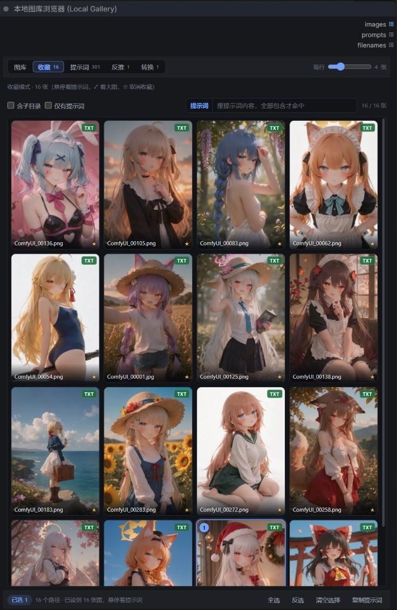
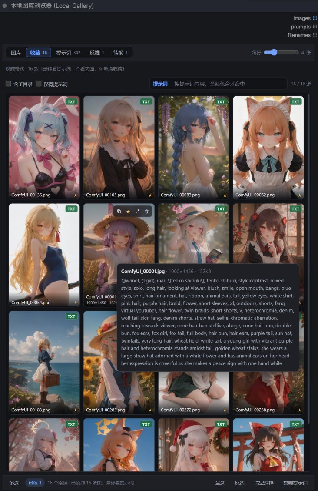
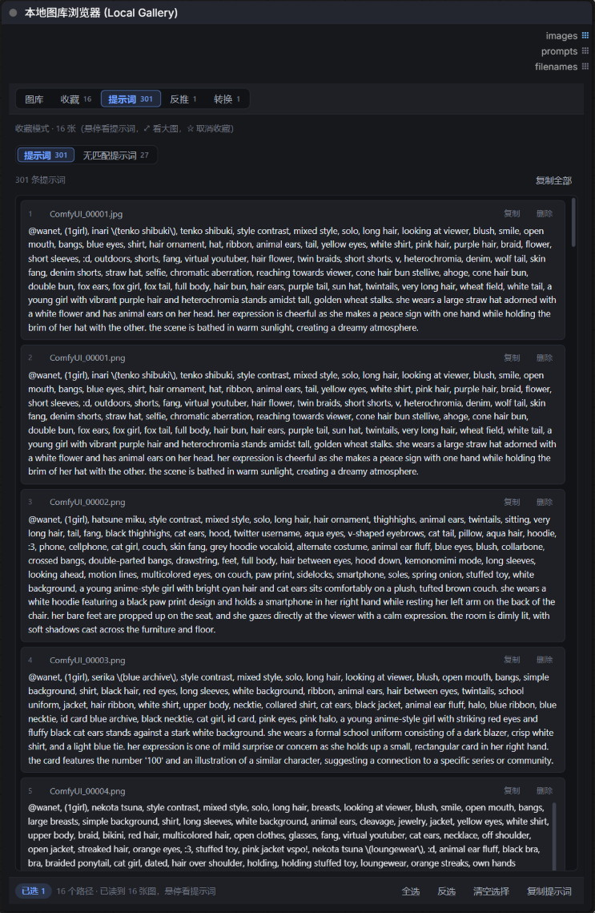
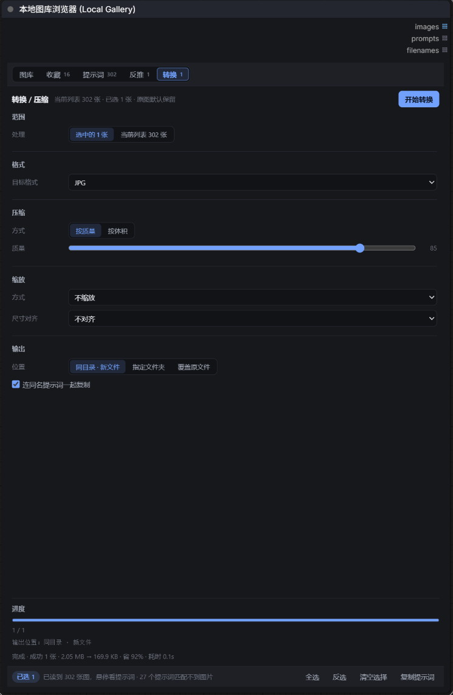
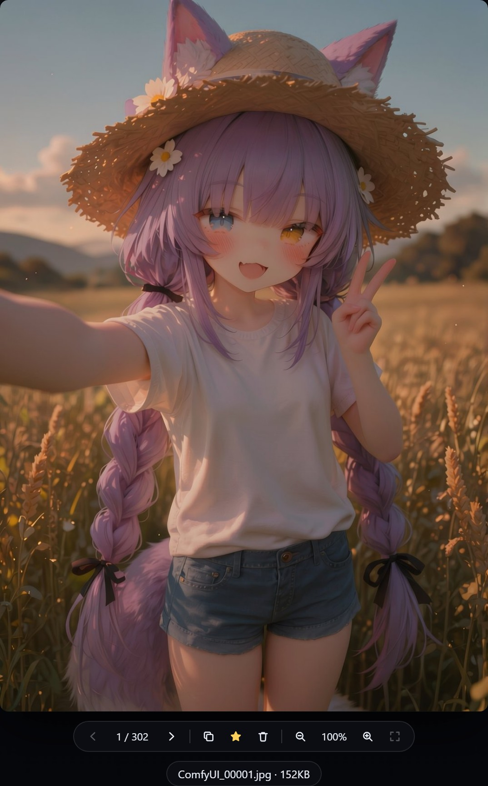
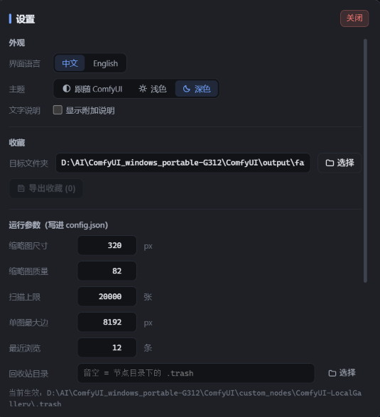

# Local Gallery for ComfyUI

Browse your local image folders right inside ComfyUI: waterfall thumbnails, hover to read the matching prompt file, click to select, and the node outputs them one by one as a list.
**Fully offline** — no network, no account, no cache written into your model folders.

[中文](README.md) ｜ [English](README_EN.md)



---

## Why use it

- **Nothing to upload** — point it at a local folder (or a single image) and you get a thumbnail wall; hundreds of images stay smooth
- **Prompts right there** — matching `a.txt / a.caption / a.json` in the same folder is picked up automatically; hover a thumbnail to read it
- **Select, then generate** — selected images and their prompts go into a hidden widget, and the node outputs them in order; wire it into KSampler / SaveImage for batch runs
- **Batteries included** — captioning (WD14 + TIPO), batch convert/compress, favorites and a trash bin, all in the same node

---

## Installation

**Option 1 — ComfyUI Manager (recommended)**

1. Open the ComfyUI menu → **Manager** → **Custom Nodes Manager**
2. Search for `local-gallery` or `Local Gallery`
3. Click **Install**, then restart ComfyUI

> Published to the [Comfy Registry](https://registry.comfy.org/nodes/local-gallery). Each new version goes through an official security review, so it may take a few minutes to show up — if it doesn't appear yet, use one of the methods below.

**Option 2 — git clone (`git pull` to update later)**

```bash
cd ComfyUI/custom_nodes
git clone https://github.com/wanet36/ComfyUI-LocalGallery.git
```

**Option 3 — download the ZIP**

1. Open the [repository page](https://github.com/wanet36/ComfyUI-LocalGallery) → green **Code** button → **Download ZIP**
2. Unzip it and drop the whole `ComfyUI-LocalGallery` folder into `ComfyUI/custom_nodes/` (rename the unzipped `-main` suffixed folder back if needed)

**Then**

1. Restart ComfyUI
2. Right-click the canvas → **local gallery** → **本地图库浏览器 (Local Gallery)**

> No extra dependencies for the node itself — it only uses the `Pillow` / `numpy` / `torch` that ship with ComfyUI.
> The only optional dependencies are for the **Caption** tab: tagging reuses an installed `ComfyUI-WD14-Tagger` (`onnxruntime`), expansion reuses `z-tipo-extension` (`kgen` + `llama-cpp-python`). Without them the node still works — just that tab is disabled.

---

## Interface tour

Five bands, top to bottom:

| Area | What's there |
|---|---|
| **Tab bar** | `Gallery / Favorites N / Prompts N / Caption N / Convert N` plus the "columns" slider |
| **Path bar** (Gallery only) | Browse, Settings, ⟳ rescan, Delete prompts, Delete selected, Trash |
| **Filter row** | Include subfolders, Only with prompt, search-scope button, search box, `hits / total` |
| **Content** | Waterfall grid (original aspect ratio, never cropped square); auto-loads the next page when you scroll (80 per page) |
| **Footer** | Single / multi-select toggle, selection count, status text, Select all / Invert / Clear selection / Copy prompts |

### Adding paths

The path list is the only entry point. Click **Browse** on the left of the path bar:

- Drill down folders on the left, tick images on the right
- **＋ Add this folder** adds the whole directory; **Add selected** adds only the ticked images
- Added paths appear in that row (`N paths added`); remove one with `✕`, or use **Clear paths**
- The dialog stays open so you can keep adding

Paths can be folders, single images, or a mix. The same file reached through several paths is only listed once.

**Survives restarts**: the list is stored in both browser `localStorage` and `.last_paths.json` in the node folder. Priority is **workflow value > local record > server record**, and the status bar says "Resumed last paths" when it kicks in.

### Browsing and selecting



- Click a thumbnail to select/deselect, `Shift + click` to select a range
- The **Multi / Single** button at the far left of the footer switches modes: Multi accumulates a batch (numbered in click order); Single keeps exactly one image, and clicking it again deselects — `Shift` is ignored in Single. The mode is remembered locally across reloads
- In Multi mode, `Ctrl / ⌘ + click` still narrows the selection down to that one image
- Hover to show the full prompt (title line: `filename · resolution · size`)
- Hovering also reveals the action group: `⧉` copy this image's prompt / `☆` favorite / `⤢` preview / `🗑` delete
  - Copy takes just that one image's prompt and confirms in the status bar; when there's no matching `.txt` the button dims and clicking explains why
  - Above 8 per row (column width < 96px) the action group drops the copy button so it never crowds the thumbnail — use the footer's Copy prompts or the Prompts tab instead
- `TXT` badge: green = prompt file exists, grey `—` = none
- The search box filters by file name / relative path; separate keywords with spaces (all must match)

---

## The five tabs

### Gallery

Default tab. Filtering, searching, selecting and bulk delete live here — it's also the only tab that shows the path bar.

The **search scope** button cycles through three modes (remembered):

| Mode | Behaviour |
|---|---|
| `Name` | Front-end only, no file reads — fastest |
| `Prompt` | Reads prompts of the current list; multiple keywords are ANDed, case-insensitive |
| `All` | Name **or** prompt matches |

### Favorites

Aggregates favorites across folders, independent of the current path list.

- Click ☆ on a thumbnail to favorite it; favorited covers get a small gold star
- Stored in `favorites.json` in the node folder — **across browsers and sessions**
- Preview, hover, viewer and delete behave exactly like the Gallery tab
- Deleting an image removes it from favorites, so no dead links
- Settings → **Favorites** can **export**: copies favorited images and prompts into a folder (existing files are skipped, never overwritten)

### Prompts



Text only, no thumbnails — built for bulk editing and copying.

- A second-level switch inside the tab: **Prompts N** / **Orphan prompts N**
- **Always follows the Gallery tab**: it lists whatever the Gallery tab is filtered to, and switching to Favorites does **not** change it (same for the tab badge)
- No need to select anything first — it lists every image in the list that has a prompt
- Each entry: index + filename + full prompt, with **Copy** / **Delete** on the right
- **Click a card to select that prompt** (click again to deselect, `Shift` for a range, `Ctrl / ⌘` to keep only that one); the index stays put and a `✓1` `✓2` marker appears **after the file name** showing the order, the footer shows "N prompts selected", and **Select all / Invert / Clear** apply to prompts too
- What you select is the **prompt only**: the node outputs those strings on `prompts` and returns an empty `images` list; image selection still lives in the Gallery tab, the two are independent (if both are selected, the Prompts tab wins)
- The text is still selectable with the mouse for copying — a drag is not treated as a card click
- **Copy all** exports in order, separated by blank lines — ready to feed the next batch
- Auto-loads on scroll (60 per page); prompts are read six at a time and cached
- Coming back to the tab remembers which mode you were in

**Orphan prompts** is the second mode: prompt files that have no image with the same name in that folder. Counting always uses the **Gallery** path list, so it works from the Favorites tab too. They can never show up in the grid, so this is the only place to read them. Each entry shows the file, its folder and the prompt text; copy one or all.

These cards **are selectable too** (the `✓` sits after the file name): they have no image by definition, so selecting them outputs only the prompt text and `images` stays empty. They share one selection set with the first mode and count together.

### Caption

Select a few images → open the **Caption** tab → caption each one → edit if needed → write back to the matching `.txt`.

It's the same chain as `LoadImage → WD14Tagger → TIPO → SaveText`, but without queueing a workflow.

| Output | Description | Speed (local CPU) |
|---|---|---|
| Tags only | Raw WD14 tags, comma separated | 0.4–2.2 s/image |
| TIPO expanded tags | Fills in danbooru tags, no prose | +2–8 s/image |
| TIPO tags + description | Tags plus an English sentence | +3–10 s/image |

- Model sources: tagging scans `ComfyUI-WD14-Tagger/models` for `.onnx` + `.csv`; expansion uses the gguf list from `z-tipo-extension`
- Graceful degradation: no tagging model → the tab says so; no TIPO → the dropdown is disabled and only tags are produced
- Write modes: `Skip if .txt exists` (default) / `Overwrite (backup .bak)` / `Append to end`
- Defaults: threshold 0.35, character threshold 0.85, "underscore to space" on (`long_hair → long hair`)
- Prefix (e.g. `@wanet`) is prepended to each line — not fed into TIPO, to keep the model input clean
- Runs in the background; closing the panel doesn't stop it. Only one job at a time
- This tab deliberately hides bulk delete, so "clear caption results" can't be mistaken for "delete images"

### Convert



Batch format conversion, size compression and resizing — **no VRAM involved**, it reads and writes files directly.

| Option | Description |
|---|---|
| Scope | Selected N images / the whole current list |
| Target format | Keep original (compress only) / JPG / WEBP / PNG / BMP / TIFF / GIF |
| Compression | **By quality** 0–100 slider; **By size** with a target KB — binary-searches the best quality that fits |
| Resize | None / by long edge / by percentage, plus size alignment (multiple of 2/8/16/32/64) |
| Output | **Same folder · new file** (`a.png → a.webp`, `a.jpg → a_c.jpg`) / **Chosen folder** / **Overwrite original** |
| Copy prompts | On by default — writes a matching `.txt` next to the new file |

- Originals are untouched by default, so you can test on a batch first
- A fixed progress bar at the bottom shows the current file and `3 / 3`; cancel any time
- Result summary: `Done · 3 converted · 7.1 MB → 208 KB · 97% smaller · 1.0s`
- You can switch tabs while it runs; progress is kept
- When outputting to a chosen folder, one click adds that folder back to the path list
- "Overwrite original" shows a red warning; overwrite + format change deletes the old file (not recoverable from Trash)
- Settings are remembered per browser

---

## Image viewer



One floating toolbar at the bottom: `‹ 3 / 300 ›` paging ｜ `⧉` copy prompt ｜ `★` favorite ｜ `🗑` delete ｜ `− 100% +` zoom ｜ `⤢` fit to window.

- **Paging**: `←` `→` keys or the arrows; disabled at the first/last image
- **Copy**: `⧉` puts the current image's prompt on the clipboard and confirms in the status bar; when there's no matching `.txt` the button dims and clicking explains why
- **Favorite**: shortcut `F`; the star on the grid thumbnail syncs immediately
- **Delete**: opens a confirm dialog, then moves image + prompt file to Trash; advances to the next image, closes when empty
- **Zoom**: wheel (centred on the pointer), double-click, `+` / `-`; 20%–800%; click the percentage to reset to 100%
- **Pan**: drag when zoomed; anything outside the stage is clipped, never breaks the window
- **Close**: `Esc` or click the dark backdrop

---

## Settings



Open it with the ⚙ button in the path bar. Four groups:

| Group | Contents |
|---|---|
| **Appearance** | Interface language (中文 / English), theme (follow ComfyUI / light / dark), show descriptions |
| **Favorites** | Export target folder + export button |
| **Runtime** | Thumbnail size / quality, scan limit, max image side, recent folders, trash folder, allow deleting, auto-pick when empty |
| **Advanced** | Allowed roots (whitelist); empty = no restriction |

Runtime values are written to `config.json` only when you click **Save settings** — effective immediately, no restart. Invalid values are rejected with a human-readable message next to the button.

| Field | Range | Notes |
|---|---|---|
| Thumbnail size | 96–640 px | Long edge; the grid re-flows immediately after saving |
| Thumbnail quality | 40–95 | JPEG quality |
| Scan limit | 100–500000 | Max files per scan; truncation is reported in the status bar |
| Max image side | 512–65536 px | Larger images are skipped when the node **runs** (saves VRAM); preview is unaffected |
| Recent folders | 3–50 | How many history entries to keep |
| Trash folder | Absolute path | Empty = `.trash` inside the node folder; the effective path is shown below |
| Allow deleting | On / Off | Read-only mode: the UI blocks every delete entry and the backend refuses too |
| Auto-pick when empty | Toggle + count + recursive | When nothing is selected, take the first N images |

- **Show descriptions** off collapses every explanatory paragraph in Settings and Convert, leaving just the controls; red warnings and the conversion summary stay visible
- **Restore defaults** only fills the form, it doesn't save
- Close with the red **Close** button or `Esc`; clicking outside does **not** close it

---

## Bilingual UI

**Settings → Appearance → Language**, two buttons: `中文` / `English`. Takes effect immediately and is remembered per browser.

It covers the whole interface: tabs and badges, path bar, filters and search, footer, Prompts / Orphan prompts, Caption, Convert, the viewer toolbar, hover tooltip, Settings, Browse, Trash, delete confirmations, and every status/error message. Sentences with numbers are translated as whole templates (`删除 3 个文件？` → `Delete 3 files?`) and re-rendered with current data when you switch.

Numbers, file names, paths and model names are never translated. Anything missing from the dictionary falls back to Chinese, so you never see a blank label.

> If you have a plugin like ComfyUI-DD-Translation that force-translates the UI into Chinese, it won't fight this: the panel and overlays carry a `.file-browser` marker that such plugins skip, and labels are rendered as elements rather than bare text nodes.

---

## Prompt matching rules

**Only matching prompt files are used — EXIF/workflow metadata embedded in the image is never read.**

"Same name" is resolved in this order (case and full-width insensitive):

1. `a.png` → `a.txt` → `a.caption` → `a.prompt` → `a.tags` → `a.md`
2. `a.png` → `a.json` (kohya `captions` array, or `prompt` / `caption` / `text` fields)
3. Folder level (kohya style): `1_hatsune miku/` → `1_hatsune miku.txt`, with the `number_` prefix stripped

Contents are returned verbatim — no trimming, no weight-bracket removal.

---

## Prompt count doesn't match?

The number of `.txt` files on disk is often larger than what the panel shows. Check these in order:

**1. Prompts without a matching image (most common)**

Scanning only pairs `a.png` ↔ `a.txt` in the same folder. A `a.txt` without `a.png` can never appear in the grid — there's no thumbnail to attach it to.

The status bar spells it out: `300 images loaded · 27 prompt files have no matching image`; hover it to see the first 8 names. To see all of them: **Prompts** tab → **Orphan prompts N**.

**2. The list is a snapshot**

Images generated while you're browsing don't appear by themselves — click ⟳ to rescan.

**3. Filters are active**

A search term or "Only with prompt" narrows the list.

**4. A card says "Read failed"**

The server was momentarily busy or timed out. Failures are not cached; the card offers a **Retry**.

---

## `config.json`

Every field is also editable from the Settings panel; editing the JSON by hand works the same.

```json
{
  "allowed_roots": [],            // empty = any path; otherwise only these roots
  "thumb_size": 320,              // thumbnail long edge
  "thumb_quality": 82,
  "max_scan_files": 20000,        // max files per scan
  "max_image_side": 8192,         // larger images are skipped at execution time
  "allow_delete": true,           // false = read-only mode
  "trash_dir": "",                // empty = .trash inside the node folder
  "recent_limit": 12,             // history entries
  "auto_select_when_empty": {     // take the first N images when nothing is selected
    "enabled": false,
    "limit": 4,
    "recursive": false
  }
}
```

---

## Node outputs

| Output | Type | Notes |
|---|---|---|
| `images` | IMAGE (list) | Each selected image, `[1,H,W,3]` float32, 0–1 |
| `prompts` | STRING (list) | Prompt for each image, read at execution time |
| `filenames` | STRING (list) | File name **without extension** (`a.png` → `a`), handy for reconciling with SaveImage |

`OUTPUT_IS_LIST = (True, True, True)`, same semantics as the original `DanbooruGalleryNode`: downstream nodes run **once per list item** (wired to KSampler, it generates every image).

> Why not the system folder dialog: the portable ComfyUI build usually has no `tkinter` in `python_embeded`, so the server can't open one. The built-in browser only talks HTTP, which works everywhere.

---

## HTTP API (used by the front end)

| Method | Path | Purpose |
|---|---|---|
| GET | `/local_gallery/list?path=&recursive=0&only_with_prompt=0` | Scan folders, returns `width` / `height` per image |
| GET | `/local_gallery/thumb?path=&size=320` | Thumbnail (disk cache) |
| GET | `/local_gallery/prompt?path=` | Prompt for one image; sidecar files report `sidecar: true` |
| GET | `/local_gallery/orphans?path=&recursive=0` | Orphan prompt details |
| GET | `/local_gallery/raw?path=` | Original image |
| GET | `/local_gallery/browse?path=` | Folder browsing (empty path returns drives) |
| POST | `/local_gallery/describe` `{"paths":[...]}` | Describe a batch of paths |
| POST | `/local_gallery/delete` `{"paths":[...]}` | Move to trash (image + prompt) |
| POST | `/local_gallery/delete_prompts` `{"paths":[...]}` | Move only prompt files, keep images |
| POST | `/local_gallery/search` `{"files":[...],"q":"a b"}` | Search prompts in the current list |
| GET | `/local_gallery/favorites` | Favorites, newest first |
| POST | `/local_gallery/favorites` `{"paths":[...],"action":"add\|remove\|toggle"}` | Toggle favorites |
| POST | `/local_gallery/favorites/export` `{"dest":"...","overwrite":false}` | Export favorites |
| GET / POST | `/local_gallery/ui/settings` | UI settings (`favorites_export_dir`) |
| GET / POST | `/local_gallery/config` | Read / write `config.json` (whitelisted fields, 400 on bad values) |
| GET | `/local_gallery/convert/info` | Convert options + whether a job is running |
| POST | `/local_gallery/convert/start` `{"paths":[...],"options":{...}}` | Start a background conversion |
| GET | `/local_gallery/convert/status?job=&since=0` | Progress + incremental results |
| POST | `/local_gallery/convert/cancel` `{"job":"..."}` | Stop before the next image |
| GET | `/local_gallery/trash` | Trash listing, grouped by batch |
| GET | `/local_gallery/trash/thumb?batch=&stored=&size=` | Trash thumbnail |
| POST | `/local_gallery/trash/restore` `{"items":[{"batch","id"}]}` | Restore to original paths |
| POST | `/local_gallery/trash/purge` `{"batch":"..."}` / `{}` | Permanently delete a batch / everything |
| GET | `/local_gallery/caption/info` | Caption config (models, defaults, TIPO availability) |
| POST | `/local_gallery/caption/start` `{"paths":[...],"options":{...}}` | Start captioning (one job at a time) |
| GET | `/local_gallery/caption/status?job=&since=0` | Caption progress + incremental results |
| POST | `/local_gallery/caption/cancel` `{"job":"..."}` | Stop captioning |
| POST | `/local_gallery/caption/write` `{"items":[...],"mode":"skip\|overwrite\|append","ext":".txt"}` | Write sidecar files |
| GET / POST | `/local_gallery/paths` | Last used path list (server-side memory) |
| GET | `/local_gallery/info` | Config overview |

`convert/start` options: `format` (`保持原格式`/`JPG`/`WEBP`/`PNG`/`BMP`/`TIFF`/`GIF`), `mode` (`按质量`/`按体积`), `quality`, `target_kb`, `allow_shrink`, `scale` (`不缩放`/`按长边`/`按百分比`), `long_side`, `percent`, `align` (`不对齐`/`2`/`8`/`16`/`32`/`64`), `output` (`同目录 · 新文件`/`指定文件夹`/`覆盖原文件`), `out_dir`, `with_prompt`.

---

## Differences from the original node

| | Original DanbooruGalleryNode | This node |
|---|---|---|
| Data source | Danbooru / Gelbooru API | Local folders / images |
| Prompts | Post tags + translation | Matching files in the same folder |
| Network | Required | Fully offline |
| Dependencies | requests, site auth | Pillow only |
| Outputs | images / prompts | images / prompts / filenames |
| Thumbnails | Site preview_url | Generated locally + disk cache |
| Paths | Keywords | Path list (folders + single images) |

The original interface shape — hidden `selection_data` widget, `OUTPUT_NODE + OUTPUT_IS_LIST` — is preserved, so nodes wired after `DanbooruGalleryNode` can be moved over as-is.

The old `optional.bypass_images` input has been removed. If you still see it on the canvas, that's a cached node definition in the browser — press `Ctrl + F5`.

---

## Project layout

```
ComfyUI-LocalGallery/
├── __init__.py          # node registration
├── nodes.py             # node definition (images / prompts / filenames)
├── gallery.py           # scanning, thumbnails, config, trash, favorites
├── routes.py            # HTTP endpoints
├── captioner.py         # caption jobs (WD14 / TIPO)
├── convert.py           # convert / compress jobs
├── prompt_reader.py     # prompt matching
├── favorites.py         # favorites persistence
├── js/local_gallery.js  # entire front end (panel, dialogs, styles, i18n)
├── config.json          # runtime settings (editable in the UI)
└── docs/                # screenshots for this README
```

---

## FAQ

**Selected images but the node outputs nothing?**
Paths and prompts are read at execution time. Make sure the images are actually selected (ring + index number) and the files still exist (broken paths turn red in the status bar).

**Where do deleted files go?**
`custom_nodes/ComfyUI-LocalGallery/.trash/<timestamp>/…`, grouped by batch. Restore or purge them from the **Trash** panel. The location is configurable in Settings.

**Why isn't a certain image on the Prompts tab?**
That tab only lists images that **have** a matching prompt file. Check the `.txt` name for a typo or a stray space.

**Can I use the gallery without ComfyUI?**
No — the front end relies on ComfyUI's node container and endpoints. You can still call the HTTP API above directly.

---

## License

[MIT](LICENSE) © 2026 wanet36

## Acknowledgements

The node structure was inspired by `DanbooruGalleryNode` from `ComfyUI-Danbooru-Gallery`. This project replaces the remote Danbooru data source with local folders, resolves prompts from same-named files sitting next to each image, and rewrites the front end plus the convert and caption flows.
